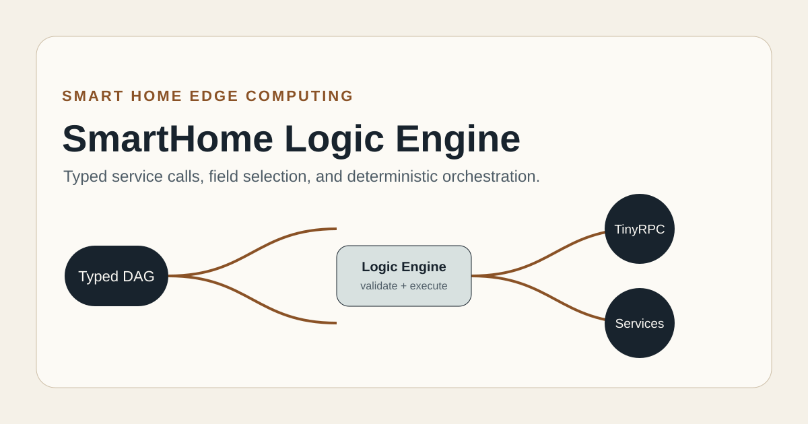
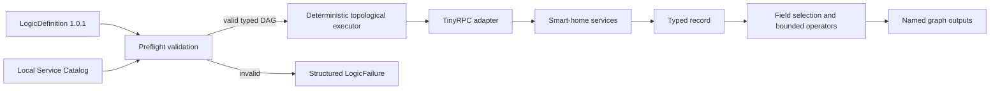

# SmartHome Logic Engine

### Typed service orchestration for smart-home edge computing

SmartHome Logic Engine turns smart-home service calls into a validated, deterministic computation graph. A graph can invoke an allowlisted service, select fields from typed records, compare values, compose boolean conditions, and perform bounded arithmetic. The engine validates the complete DAG before any network side effect.

This repository also preserves the earlier registry-backed Netty RPC implementation. The new engine consumes it through an explicit `legacy-typed-netty` gateway and uses the separate Smart Home Communication repository through a real `tiny-rpc-netty` adapter. The two wire protocols remain intentionally distinct.

## Execution model



Preflight rejects duplicate or missing nodes, cycles, unknown services and operations, argument-count and signature mismatches, invalid record fields, unsafe node kinds, and incompatible operators before dispatch. Record values are limited to 32 fields and four nesting levels. The runtime applies graph and node deadlines, finite-number bounds, structured missing-field errors, and exact output checks without `eval`, shell execution, arbitrary class loading, implicit coercion, fallback invocation, or silent retry.

## Modules

| Module | Responsibility |
| --- | --- |
| `logic-engine-core` | typed values, contract models, local service catalog, DAG validation, and deterministic execution |
| `logic-engine-tiny-rpc-adapter` | real Smart Home Communication client/provider bridge and CLI; enabled with `-DtinyRpcAdapter` |
| `logic-engine-legacy-adapter` | explicit allowlisted gateway to the preserved 16-byte typed Netty protocol |
| `rpc-common-protocol` | preserved 16-byte framing, correlation, Netty transport, and Spring bridge |
| `rpc-common-registry` | preserved ZooKeeper registration and discovery adapter |
| `rpc-service-provider`, `rpc-service-consumer` | legacy loopback examples |

## Frozen integration contract

The engine was developed against Smart Home Hub catalog version `1.0.1` at exact commit `ff569fdb97a7ad1f2a33665bd3eaceb1bcd28075`. The frozen `contracts/INTEGRATION_API.md` SHA-256 is `a6b41f12ea80d2ea4872a34fd7c8b638ad6d4be19e14695ad0bd9dcb99a4365e`; machine-readable provenance is stored in [`integration/contracts-hub.json`](integration/contracts-hub.json).

Typed records follow the Hub contract. `select-field` accepts exactly one node-output record, requires a declared field/signature match during preflight, and reports `logic.missing-field` or `logic.field-type-mismatch` at runtime rather than returning a default.

## Build and verify

JDK 8 and Maven 3.6+ are required. Install Smart Home Communication locally first when testing the TinyRPC adapter.

Current engine artifacts use the neutral `io.smarthome` Maven group. The real transport bridge is `io.smarthome:logic-engine-tiny-rpc-adapter:1.0-SNAPSHOT`; Java packages remain under `io.smarthome.logic.*`.

```bash
# In Smart Home Communication
mvn --batch-mode --no-transfer-progress -DskipTests install

# In this repository
mvn --batch-mode --no-transfer-progress test
mvn --batch-mode --no-transfer-progress -DtinyRpcAdapter test
```

The core and adapter tests cover deterministic graph ordering, cycles and references, service/operation/signature preflight, unknown operators and unsafe kinds, constant divide-by-zero, bounded math, node timeout, record depth/field limits, strict typed JSON, runtime missing/mismatched fields, legacy gateway isolation, and a real TinyRPC loopback returning a typed record with same-session frame observations.

## TinyRPC provider API

```java
TinyRpcServer.Builder builder = TinyRpcServer.builder();
TinyRpcTypedProvider.register(builder, "sensor.service", "read.state", arguments -> typedRecord);
TinyRpcServer server = builder.build().bind("127.0.0.1", 0);

LocalEndpointCatalog endpoints = new LocalEndpointCatalog()
    .register("local.catalog", "127.0.0.1", server.port());
TinyRpcTransportAdapter adapter = new TinyRpcTransportAdapter(endpoints, RpcLimits.defaults(), telemetry);
```

`io.smarthome.logic.tinyrpc.TinyRpcLogicCli` provides machine-readable `provider-ready` and `invocation-result` JSON for local cold-source integration. The provider command binds only to loopback and accepts an OS-assigned port:

```text
provider <port|0> <serviceId> <operation> <typedValueJson>
invoke <host> <port> <serviceId> <operation> <typedArgumentsJson>
invoke-graph <host> <port> <serviceId> <operation> <typedArgumentsJson> --descriptor-file <path> --trace-file <new-path>
```

`invoke-graph` validates a frozen Hub `ServiceDescriptor`, constructs a typed one-call DAG, and executes the real Logic Engine through TinyRPC. It writes a new payload-free `TrafficTrace` 1.0.2 file containing both observed frames on one session clock before emitting the result. The result includes `logicDefinition` serialized from the exact validated graph object, allowing Management to persist and read back the graph that produced the recorded invocation. The caller must profile that trace and persist a scheduling decision before invoking a separate action graph. Direct `invoke` provides an independent state read; it does not establish graph execution. Missing traces, signature mismatches, and unknown operations fail explicitly.

## Preserved protocol boundary

The legacy protocol retains its 16-byte header, JSON-only network serializer, request correlation, timeout/disconnect cleanup, and disposable real ZooKeeper/Netty loopback test. Spring and ZooKeeper stay outside the new engine core. The older `integration/compatibility.py` manifest references superseded repository revisions and is retained only as historical evidence; the Hub exact-commit cold-source runner is the publication authority.

## Research provenance

The system is presented as independent research. The typed graph engine and TinyRPC bridge are current engineering; older RPC modules remain visible to show the protocol evolution and are not described as the new engine implementation.

## Rights

See [`RIGHTS.md`](RIGHTS.md). No open-source reuse license is granted for the owner's original contribution.
