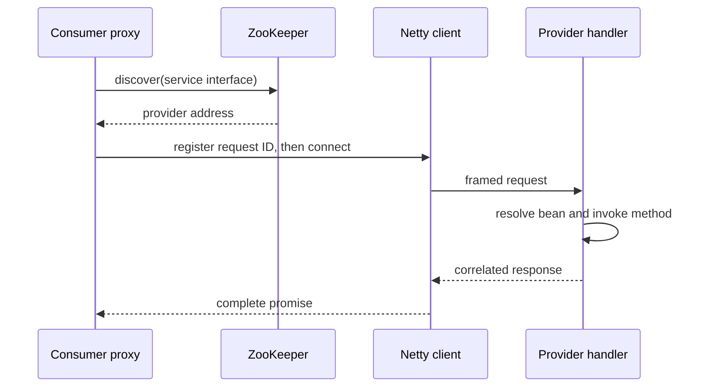

# SmartService Discovery RPC

SmartService Discovery RPC is a learning-oriented Java RPC implementation that combines Netty transport, dynamic proxies, Spring-based service exposure, and ZooKeeper service discovery. It demonstrates the complete path from an annotated consumer call to provider-side reflection and a correlated response.

## Architecture



The proxy API is synchronous: the caller waits for a response or a five-second request deadline. Network I/O remains asynchronous inside Netty. Connections are bounded by a three-second connect timeout, frames are limited to 1 MiB, and request correlations are removed on response, write/connect failure, timeout, cancellation, or channel close. Network frames accept JSON serialization only; Java object serialization and unknown serializer identifiers are rejected before payload deserialization. Fastjson auto-type support is disabled in safe mode.

## Modules

- `rpc-common-interface` — shared service contracts.
- `rpc-common-registry` — ZooKeeper registration, discovery, and load balancing.
- `rpc-common-protocol` — framing, serialization, correlation, transport, and Spring integration.
- `rpc-service-provider` — loopback provider example.
- `rpc-service-consumer` — loopback consumer example.

## Run the loopback demo

Prerequisites: JDK 8, Maven 3.6+, and ZooKeeper listening on `127.0.0.1:2181`.

```bash
mvn --batch-mode --no-transfer-progress test
mvn --batch-mode --no-transfer-progress -DskipTests install
mvn -pl rpc-service-provider spring-boot:run
```

In a second terminal:

```bash
mvn -pl rpc-service-consumer spring-boot:run
curl 'http://127.0.0.1:8080/getUser?id=1001'
curl 'http://127.0.0.1:8080/getUsers'
```

Both sample applications use loopback addresses. Change the properties files explicitly when testing across machines.

## Protocol

Each frame contains a 16-byte header: magic number, serializer, message type, request ID, and payload length. The decoder waits for fragmented payloads and rejects non-JSON serializers, negative lengths, unsupported message types, and oversized frames before deserialization or allocation.

## Test

```bash
mvn --batch-mode --no-transfer-progress test
```

The test suite also starts a disposable in-process ZooKeeper server and a real Netty provider on an ephemeral loopback port. It verifies rapid and concurrent correlated calls, exact `RuleSpec` JSON-string transport, request timeout, provider disconnect, pending-map cleanup, and client thread shutdown. No external registry or Docker service is used by the integration test.

Run only this verified smoke matrix with:

```bash
mvn -pl rpc-common-protocol -am \
  -Dtest=integration.RpcLoopbackIntegrationTest \
  -Dsurefire.failIfNoSpecifiedTests=false test
```

## RuleSpec suite integration

The [`integration/`](integration/) directory contains the shared RuleSpec v0 JSON Schema, immutable fixture, explicit adapter capability matrix, and offline compatibility runner for the scheduler, analyzer, composer, and this RPC transport. The generated proof records exact commands and repository states. It makes no general interoperability or production claim.

```bash
python3 -m unittest discover -s integration/tests -v
python3 integration/compatibility.py
```

See the [integration contract and publication procedure](integration/README.md) before enabling its pending CI template.

## Limitations

- ZooKeeper is the only registry implementation included.
- The public proxy API blocks the calling thread.
- JSON is the only accepted network serialization format, and there is no schema negotiation.
- Authentication, encryption, retries, circuit breaking, and production observability are outside the current scope.
- No performance or production-readiness claim is made.

## License

No license has been declared for this repository. Copyright remains with the repository owner unless a license is added explicitly.
